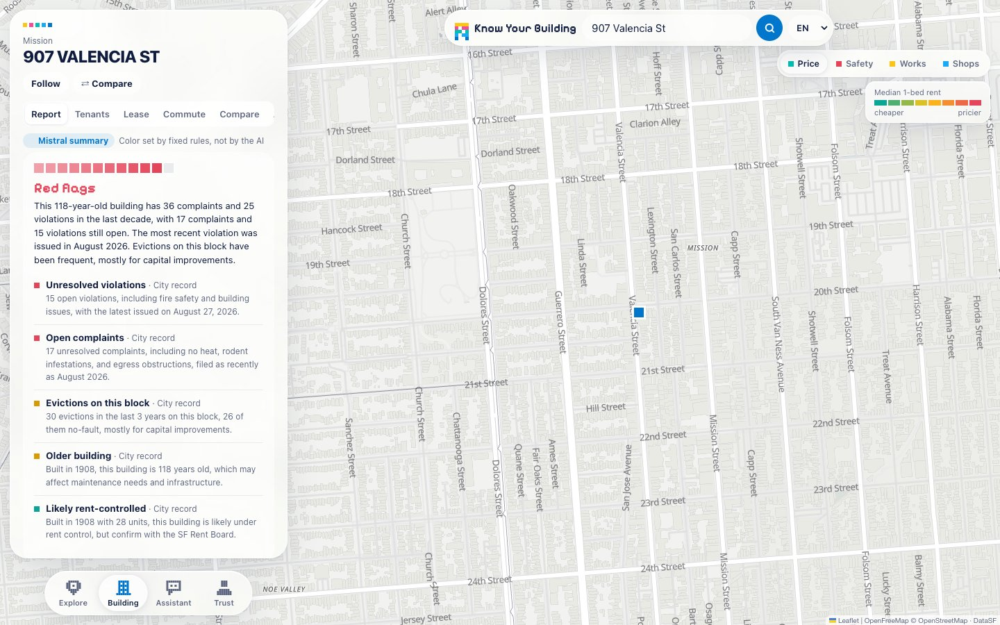

# Know Your Building

**Know the building before you sign.** Type any San Francisco address and get a plain-language report on the building, written by Mistral from the city's own open data: complaints and violations, permits and works, evictions on the block, fire calls, police incidents nearby and 311 reports. Then hear from tenants, check your lease, and find a neighborhood that fits your budget.

🔗 **Live demo: https://know-your-building-lm5f.onrender.com** (free hosting: the first load can take up to a minute while the server wakes up)

Built in one evening at the **Mistral AI × Elastic hackathon**, San Francisco, November 2026.


## Why

Nearly two thirds of San Francisco households rent. You get a fifteen-minute showing, a few photos, and a lease to sign by tomorrow. Meanwhile the city already publishes a lot about that building, scattered across datasets no renter reads. Know Your Building turns them into an answer in seconds.

## What it does

| | |
|---|---|
| **Building report** | A verdict (green / orange / red, set by fixed rules, not by the model) and a Mistral summary, separated from the official records. The records are grouped by theme: building & works, safety, tenant stability (evictions *on the street block*, no-fault evictions flagged), and building profile. Elastic compares the building with its neighbors. |
| **Tenant reviews** | Ratings and reviews, labeled as opinions, not facts. A "Verified tenant" badge when the reviewer uploads a lease or bill: Mistral OCR checks the address and the file is never stored. Every review is moderated by Mistral. |
| **Lease check** | Upload a lease: Mistral OCR reads it and flags clauses that may break SF rent rules, with the rule reference, then drafts a letter to the landlord. |
| **Map** | Vector map of the 41 neighborhoods, colored by median rent or by police incidents, plus layers for recent permits (works) and shops. |
| **Assistant** | Describe what you need in your own words ("2 people in the Mission, $4k max, 1 year"). It asks for what's missing, outlines matching neighborhoods on the map and pins places. |
| **Trust network** | Inspired by Paris' "Gens de confiance": recommendations from friends, former landlords and roommates, contactable tenants of the building, and roommate matching that never uses gender, religion or origin. |
| **More** | Follow a building and see what changed, compare two buildings side by side, commute times, four languages (EN, ES, 中文, FR). |

| Mistral verdict | Official records, by theme |
|---|---|
|  |  |
| **Assistant + map** | **Trust network** |
|  |  |

## Data

All building data comes live from [DataSF](https://data.sf.gov) (Socrata):

| Dataset | ID |
|---|---|
| Eviction notices | `5cei-gny5` |
| DBI complaints | `gm2e-bten` |
| DBI notices of violation | `nbtm-fbw5` |
| Building permits | `i98e-djp9` |
| Assessor tax rolls | `wv5m-vpq2` |
| 311 cases | `vw6y-z8j6` |
| Fire incidents | `wr8u-xric` |
| Police incidents | `wg3w-h783` |
| Rent Board housing inventory | `gdc7-dmcn` |
| Addresses, parcels, neighborhoods | `ramy-di5m`, `acdm-wktn`, `j2bu-swwd` |

Map tiles: [OpenFreeMap](https://openfreemap.org) / OpenStreetMap. Shops: OpenStreetMap (Overpass). Commute estimates: OSRM and Nominatim.

**Good to know**
- The city anonymizes evictions and rents at the **street block** level ("900 Block Of Valencia Street"): the app always says "on this block", never "this building".
- Rent-control status is indicative (built before 1979 with 2+ units).
- Map rents come from the Rent Board inventory (self-reported, including long-time tenants), so they run below current asking rents.
- Reviews, the trust network and listings shipped with the demo are fictional sample data. Reviews from the seed are labeled "fictional example".
- Informational only, not legal advice.

## Stack

- **Front end:** a single `frontend/index.html` (HTML, CSS, vanilla JS), Leaflet with a MapLibre vector basemap. The design mixes Apple-style "liquid glass", Mistral-style pixel art and the Elastic palette.
- **Back end:** Python, FastAPI, SQLite for the community features (`backend/`).
- **AI:** Mistral Large (reports, moderation, roommate matching), Mistral OCR (lease analysis, proof of tenancy), Mistral Embed (multilingual semantic search) (`llm/`).
- **Search:** Elasticsearch, about 72,000 geolocated DBI complaints and violations, used for neighbor benchmarks and full-text search (`backend/search.py`).
- **Hosting:** Render (one web service serves both the API and the front end).

## Run it locally

```bash
python3 -m venv .venv && source .venv/bin/activate
pip install -r requirements.txt
cp .env.example .env            # then set MISTRAL_API_KEY
uvicorn backend.main:app --reload --port 8000      # from the repo root
```

Open http://localhost:8000/ (or http://localhost:8000/?address=907%20Valencia%20St to jump to a report).
Interactive API docs: http://localhost:8000/docs · what's plugged in: `curl localhost:8000/api/health`.

Without `MISTRAL_API_KEY` the app still runs, with rule-based summaries; new reviews are refused because moderation is required. Without Elastic, everything else works.

Demo reviews and profiles are loaded from `seed/seed_community.json` on first start (delete `community.db` to reload them).

## Deploy (Render)

`render.yaml` describes one free web service:
- build: `pip install -r requirements.txt`
- start: `uvicorn backend.main:app --host 0.0.0.0 --port $PORT`
- health check: `/api/health`

Create it from the Render dashboard (**New → Blueprint**, pick this repo) and paste `MISTRAL_API_KEY` when asked. The key is never stored in the repo. Optional: `ELASTIC_URL` and `ELASTIC_API_KEY` for the Elastic features.

On the free plan the disk is temporary: new reviews disappear when the service restarts, and the demo data reloads.

## API

```
GET  /api/report?address=&lang=en|es|zh|fr   -> {building, report, community}
GET  /api/building?address=                   -> aggregated city data
POST /api/summary      body = /api/building output
POST /api/lease        multipart, field "file"   -> {clauses: [{text, issue, severity, rule_ref}]}
GET  /api/community?blklot=
POST /api/reviews      multipart: review=<JSON>, proof=<optional file, never stored>
POST /api/profiles  ·  GET /api/roommates?profile_id=  ·  POST /api/contact
GET  /api/benchmark?address=&radius_m=500      (Elastic)
GET  /api/search?q=no heat&address=&radius_m=800&open_only=true&semantic=true   (Elastic)
GET  /api/health
```

See `contract.md` and `FRONT.md` for the full formats.

### Elastic setup (optional, 5 min)

1. A cluster: Elastic Cloud (copy the Elasticsearch endpoint URL and create an API key), or locally:
   `docker run -d -p 9200:9200 -e discovery.type=single-node -e xpack.security.enabled=false docker.elastic.co/elasticsearch/elasticsearch:8.15.3`
2. In `.env`: `ELASTIC_URL=...` (and `ELASTIC_API_KEY=...` for the cloud).
3. `python backend/search.py ingest --years 3` (about 40 s). Add `--embed` for semantic search (calls Mistral, slower).
4. `curl localhost:8000/api/health` should show `"elastic": {"docs": 71763, ...}`.

For an Elastic Cloud 9.x cluster, use `elasticsearch>=9,<10` in `requirements.txt`.

## Demo addresses (real data)

| Role | Address | Highlights |
|---|---|---|
| Problematic | 907 Valencia St | 17 open DBI complaints, 25 notices of violation, 33 eviction notices on the block |
| Well kept | 2288 Broadway | 30 units, zero complaints in 10 years |
| Evictions | 3033 Cesar Chavez St | 9 Ellis Act or owner move-in evictions on the block in 5 years |

## Project structure

```
backend/    FastAPI app, DataSF aggregation, community (SQLite), Elastic search
llm/        Mistral: reports, lease analysis, moderation, proof check, matching
frontend/   the web app (single index.html)
seed/       demo reviews and profiles
mocks/      sample API responses and demo lease PDFs
docs/       screenshots
```

## Team

| | Role |
|---|---|
| **Fleurine Jaegler** ([@fleurinejaegler](https://github.com/fleurinejaegler)) | Back end & data: DataSF pipeline, API, Elastic |
| **Thomas Revol** ([@ThomasREVOL](https://github.com/ThomasREVOL)) | AI: Mistral reports, OCR lease analysis, moderation, matching |
| **Colomban Dubreuil** ([@C0lomban](https://github.com/C0lomban)) | Front-end prototype & demo data |
| **Daniel Duong** ([@danielguitaristo](https://github.com/danielguitaristo)) | Front end: interface, map, assistant, design |
